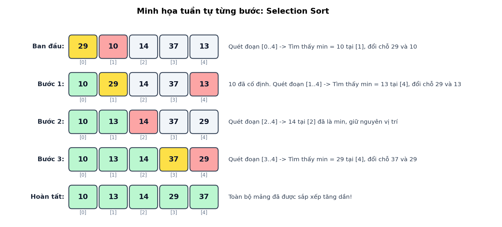
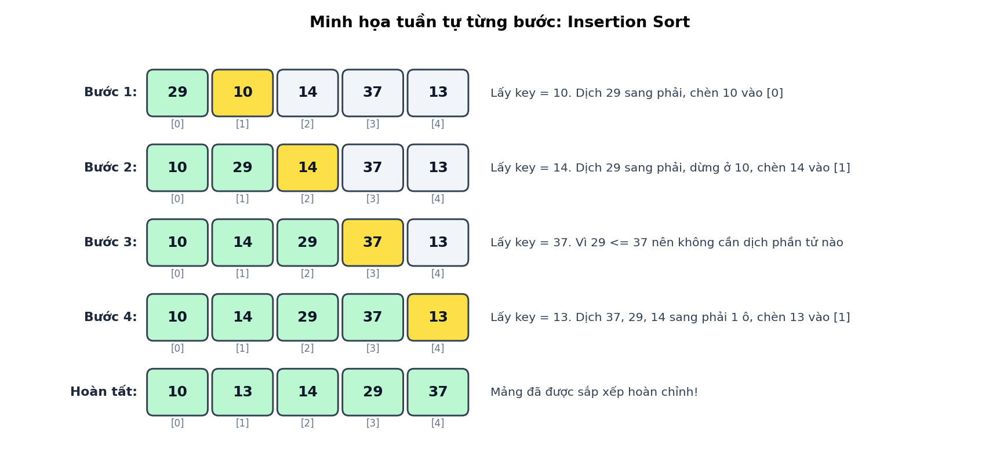
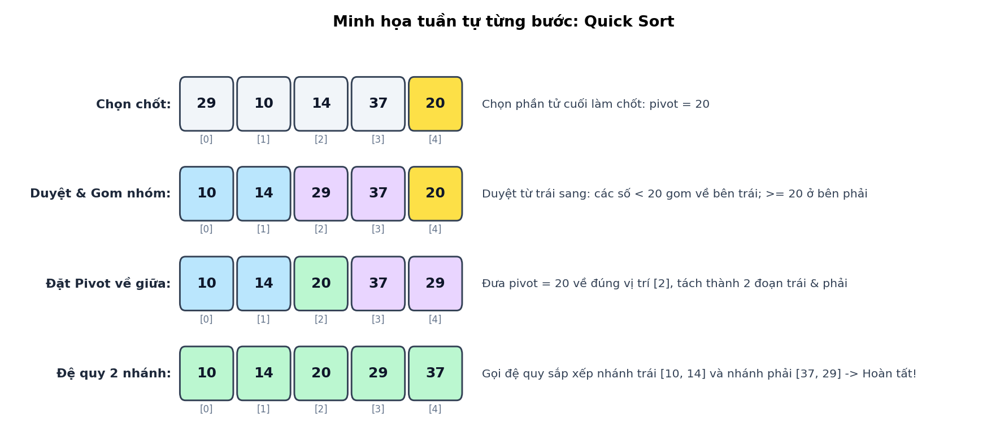

# Assignment 1: Phân tích Hiệu năng Thuật toán Sắp xếp Cơ bản

Chào mừng các bạn CTV SRC 2026 đến với Assignment 1. Mục tiêu của bài tập này là cài đặt 3 thuật toán sắp xếp: **Selection Sort, Insertion Sort và Quick Sort**, sau đó phân tích định lượng sự thay đổi về hiệu năng giữa các thuật toán thông qua hệ thống đo đạc tự động.

## Cấu trúc Repository
- `src/sorts.cpp`: **File duy nhất các bạn được phép chỉnh sửa.**
- `src/main.cpp` & `include/sorts.h`: Hạ tầng đo lường thời gian chạy ($μs$). Không được chỉnh sửa.
- `scripts/test_debug.py`: Script kiểm tra tính đúng đắn trên mảng nhỏ ($N \le 20$).
- `scripts/harness.py`: Benchmark suite tự động đo đạc và xuất biểu đồ so sánh với binary code mẫu.

## 1. Môi trường và Quy trình thực hiện

Để thực hiện các bước dưới đây, yêu cầu CTV đã tải `C/C++` và `Python` trên máy. Nếu chưa tải, có thể theo chỉ dẫn của các link này:
- [C/C++](https://code.visualstudio.com/docs/languages/cpp)
- [Python](https://code.visualstudio.com/docs/languages/python)
### Bước 1: Mở Workspace trên VS Code
1. Khởi động VS Code. Chọn **File $\to$ Open Folder...** (hoặc `Ctrl + K, Ctrl + O`).
2. Chọn thư mục `assigment1`

### Bước 2: Khởi tạo Terminal
1. Mở terminal tích hợp: **Terminal $\to$ New Terminal** (hoặc `` Ctrl + ` ``).
2. Đảm bảo dấu nhắc lệnh đang nằm tại thư mục gốc của assignment.

Ví dụ trên Windows:
```bash
PS C:\...\...\Assignment1>
```
Ví dụ trên Linux:
```bash
username@hostname:~/Assignment1$
```

### Bước 3: Cài đặt môi trường
Chạy lệnh sau để thiết lập môi trường ảo Python và các thư viện vẽ đồ thị:
```bash
make venv
```
Kích hoạt môi trường ảo:
- **Windows (PowerShell):**
  ```powershell
  .venv\Scripts\Activate.ps1
  ```
  *(Nếu gặp lỗi script execution, chạy `Set-ExecutionPolicy -Scope Process -ExecutionPolicy Bypass` rồi kích hoạt lại).*
- **Windows (Git Bash / MSYS2):**
  ```bash
  source .venv/Scripts/activate
  ```
- **Linux / macOS:**
  ```bash
  source .venv/bin/activate
  ```

### Bước 4: Cài đặt Thuật toán
Mở `src/sorts.cpp` và code 3 hàm:
- `void selectionSort(int* arr, int n);`
- `void insertionSort(int* arr, int n);`
- `void quickSort(int* arr, int n);`

**Lưu ý**: Không thay đổi tên của hàm. Không dùng `std::sort`, `qsort()` hoặc các thư viện sắp xếp có sẵn (`<algorithm>`, v.v..).

### Bước 5: Biên dịch
Biên dịch file code .cpp thành binary để kiểm thử bằng lệnh:
```bash
make
```
Đảm bảo mã nguồn được compile sạch, không có cảnh báo (`-Wall -Wextra`) khi đang compile.

### Bước 6: Kiểm tra tính đúng đắn (`make test`)
Trước khi chạy benchmark, bắt buộc phải vượt qua toàn bộ unit test trên mảng nhỏ ($N \le 20$):
```bash
make test
```
Nếu có lỗi, script sẽ chỉ rõ đầu vào `Input`, 2 đầu ra `Expected` (từ reference binary của CLB. Đừng lo, bọn a code đúng hết r nhé *:))* ) và `Actual` (từ code của bạn). Debug tại bước này trước khi sang bước tiếp theo.

### Bước 7: Chạy Benchmark (`make run`)
Sau khi pass `make test`, chạy benchmark toàn diện:
```bash
make run
```
Script sẽ thực thi 4 bài đo dữ liệu trên 3 quy mô kích thước (`small`, `large`) và tự động lưu các biểu đồ vào thư mục `graphs/`.


## 2. Yêu cầu Thuật toán

### 2.1. Selection Sort
Duyệt qua mảng có $n$ phần tử $[0 \dots n-1]$, tại mỗi vị trí $i$ tìm phần tử nhỏ nhất trong đoạn $[i \dots n-1]$ và hoán đổi về vị trí $i$.




---

### 2.2. Insertion Sort
Duyệt từ mảng có $n$ phần tử, từ phần tử thứ 1 đến $n-1$. Tại mỗi bước, chèn phần tử `key = arr[i]` vào đúng vị trí trong đoạn tiền tố đã sắp xếp $[0 \dots i-1]$ bằng cách dịch các phần tử lớn hơn sang phải.



> **Tips:**
> Nếu `arr[i] >= arr[i - 1]`, phần tử đã đứng đúng vị trí. Có thể bỏ qua vòng lặp luôn!

---

### 2.3. Quick Sort
Triển khai giải thuật chia để trị (*recursion*): chọn phần tử cuối mảng `arr[high]` làm `pivot`, phân hoạch mảng thành 2 phần $(< pivot$ và $\ge pivot$), sau đó đệ quy sắp xếp 2 nửa.



Pseudo code tham khảo:
```cpp
Hàm quickSortHelper(đoạn mảng cần xét):
    Nếu đoạn mảng có từ 2 phần tử trở lên:
        p = Gọi hàm partition để dồn phần tử và đặt chốt vào đúng vị trí
        Gọi đệ quy quickSortHelper cho nửa mảng bên trái chốt
        Gọi đệ quy quickSortHelper cho nửa mảng bên phải chốt
Hàm quickSort(arr, n):
    Gọi hàm quickSortHelper trên toàn bộ mảng từ đầu đến cuối
```

## 3. Benchmark và Báo cáo Phân tích

Sau khi thực thi `make run`, kiểm tra 4 thư mục kết quả trong `graphs/`:
- `graphs/random/`: Dữ liệu phân bố đều ngẫu nhiên.
- `graphs/nearly_sorted/`: Dữ liệu gần như đã sắp xếp.
- `graphs/reverse/`: Dữ liệu đảo ngược hoàn toàn.
- `graphs/few_unique/`: Dữ liệu có 98% phần tử trùng lặp.

Mỗi thư mục chứa 3 biểu đồ: `small_0_500.png` và `large_10000_20000.png`. Đường nét liền (`Student`) là kết quả thực thi của bạn; đường nét đứt (`Ref`) là reference implementation của CLB.

Hướng dẫn quan sát
- **Trục tọa độ:** Trục hoành biểu diễn kích thước mảng $N$, trục tung biểu diễn thời gian thực thi ($μs$). Đường càng thấp, thuật toán chạy càng nhanh.

---

### BTVN

Trả lời các câu hỏi sau và xuất báo cáo ra file `.pdf`:
- Hãy vẽ lưu đồ thuật toán của các thuật toán (khuyên dùng draw.io)

- Quan sát đường biểu diễn của Selection Sort trên cả 4 bài đo (ngẫu nhiên, gần như sắp xếp, đảo ngược, trùng lặp). Thời gian chạy có thay đổi đáng kể không? Vì sao?

- Khi nào Insertion Sort vươn lên vị trí dẫn đầu? *Gợi ý:* nhìn vào cấu trúc vòng lặp của bạn, số phép hoán đổi thay đổi như thế nào khi mảng đã gần sắp xếp hoặc có nhiều giá trị bằng nhau?

- Tại sao trên dữ liệu ngẫu nhiên ở quy mô mảng lớn ($N = 10,000 \to 20,000$), Quick Sort lại bỏ xa hai thuật toán còn lại?

- Tại sao ở mảng kích thước nhỏ ($N \le 100$), Quick Sort lại chậm hơn Insertion Sort? *Gợi ý:* hãy suy nghĩ về hàm đệ quy các hoạt động của hàm đề quy dưới code

- Lập bảng so sánh tổng kết về 3 thuật toán: Độ phức tạp thời gian (Best, Average, Worst Case), dữ liệu nào tối ưu nhất, dữ liệu nào tồi tệ nhất của mỗi thuật toán.

- *Bonus:* Nhìn vào đường nét đứt `QUICK (Ref)` của CLB: tại sao phiên bản này không hề bị suy biến ở các trường hợp dữ liệu không tối ưu mà vẫn giữ được tốc độ ổn định?

---
### Tài liệu tham khảo
- [Flowchart](https://www.geeksforgeeks.org/dsa/an-introduction-to-flowcharts/)
- [Sorting](https://www.geeksforgeeks.org/dsa/introduction-to-sorting-algorithm/)
- [Big O Notation](https://www.geeksforgeeks.org/dsa/analysis-algorithms-big-o-analysis/)
- [Recursion](https://www.geeksforgeeks.org/dsa/introduction-to-recursion-2/)
